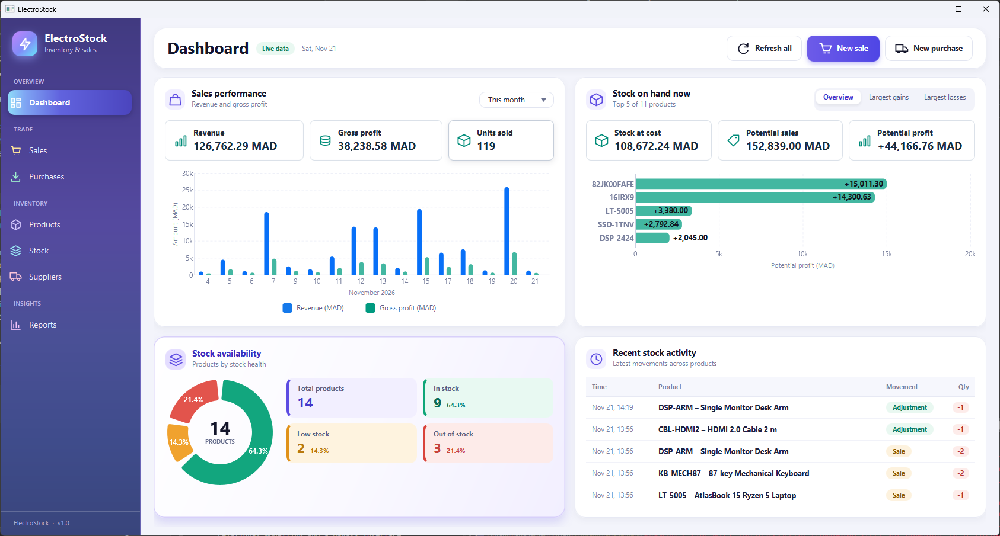
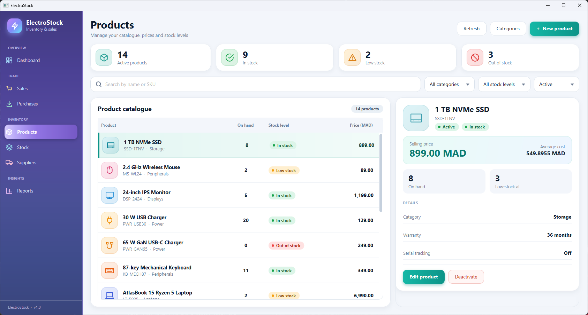
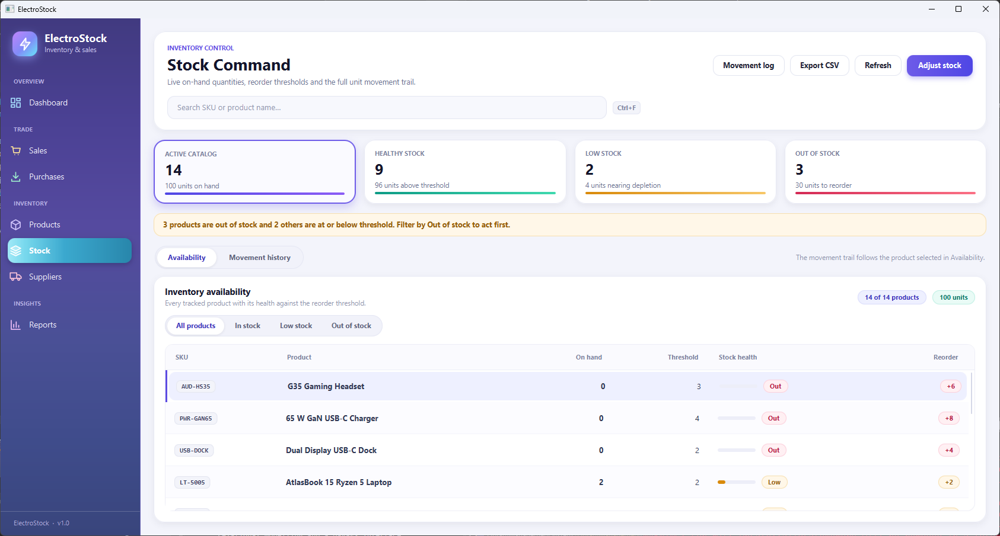
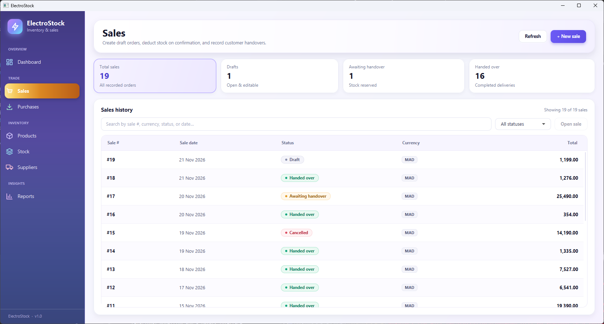
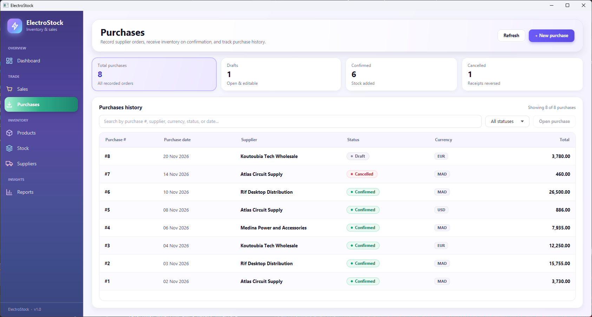
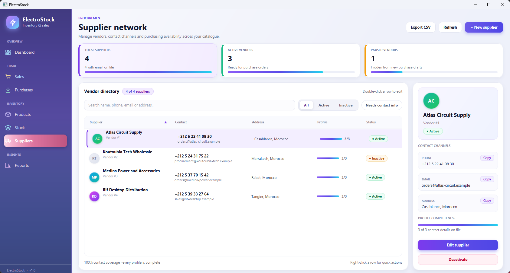
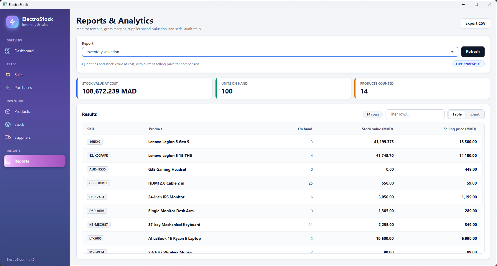

<div align="center">

# ⚡ ElectroStock

**A desktop inventory system for electronics shops.**
Serial-numbered devices, multi-currency purchases, and profit reports built on real historical cost.


<br>



<sub>The dashboard, loaded with the demo data from <code>database/SeedDemoData.java</code></sub>

</div>

> **About this project.** ElectroStock was built for education: to practise layered backend design, transactional business rules, relational modelling and a JavaFX interface. It is not finished and not meant for production use. The [limitations](#known-limitations) are listed openly below.

---

## Contents

[Overview](#overview) · [Screenshots](#screenshots) · [Features](#features) · [Architecture](#architecture) · [Tech stack](#tech-stack) · [Getting started](#getting-started) · [Configuration](#configuration) · [REST API](#rest-api) · [Business rules](#business-rules) · [Known limitations](#known-limitations) · [Project structure](#project-structure) · [Documentation](#documentation)

---

## Overview

ElectroStock tracks products, suppliers, purchases, sales and stock movements in one place.

- 🔢 **Serial-tracked units.** Phones, laptops and other devices are handled one by one, each with its own cost.
- 💱 **Foreign currencies.** Buy from suppliers in EUR or USD; MAD is the base currency and the rate is stored with every transaction.
- 📈 **Honest profit.** Cost of goods sold is captured at sale time, so later cost changes never rewrite past profit.
- 🧾 **Stock you can trust.** Quantity on hand is derived from an append-only movement history.

## Screenshots

<table>
  <tr>
    <td width="50%" align="center">
      <br>
      <b>Products</b><br>
      <sub>Search, filter, and manage categories in place</sub>
    </td>
    <td width="50%" align="center">
      <br>
      <b>Stock</b><br>
      <sub>Adjustments, serial units and movement history</sub>
    </td>
  </tr>
  <tr>
    <td width="50%" align="center">
      <br>
      <b>Sales</b><br>
      <sub>Draft, confirm, hand over, cancel</sub>
    </td>
    <td width="50%" align="center">
      <br>
      <b>Purchases</b><br>
      <sub>Multi-currency drafts that add stock on confirm</sub>
    </td>
  </tr>
  <tr>
    <td width="50%" align="center">
      <br>
      <b>Suppliers</b><br>
      <sub>Contacts with their purchase history kept</sub>
    </td>
    <td width="50%" align="center">
      <br>
      <b>Reports</b><br>
      <sub>Valuation, profit, serial tracing, CSV export</sub>
    </td>
  </tr>
</table>

## Features

| Screen | What it does |
| --- | --- |
| **Dashboard** | Revenue, gross profit and units sold for the month or today with a daily chart, stock-availability donut, potential profit by product, and the latest stock movements |
| **Products** | Searchable catalogue with filters (category, stock level, status); create, edit, deactivate and reactivate products; manage categories without leaving the screen |
| **Stock** | Opening stock, quantity adjustments, serial-unit additions, removals and recovery, and a full movement history per product |
| **Sales** | Draft sales, stock checks, confirmation with cost-of-goods capture, handover (which starts the warranty), and cancellation before handover |
| **Purchases** | Draft purchases per supplier in any supported currency; confirming one adds stock in a single transaction; cancellation while the stock can still be taken back |
| **Suppliers** | Register, edit, activate and deactivate suppliers, with their purchase history kept |
| **Reports** | Inventory valuation, low stock, stock movements, sales by product and category, gross profit by product, purchases by supplier, daily sales and serial-number tracing, with CSV export |

## Architecture

A client-server application. The JavaFX client holds no business rules; the backend validates every request.

```text
JavaFX desktop ──HTTP/JSON──▶ Spring Boot REST API ──▶ Services ──▶ Repositories ──▶ MariaDB
                                                          │
                                                          └──▶ Frankfurter API (exchange rates, cached)
```

- **Controllers** expose the REST endpoints and map requests to DTOs.
- **Services** hold the business rules and run each operation in one transaction.
- **Repositories** (Spring Data JPA) access MariaDB. The schema is created by hand from `database/schema.sql`; Hibernate never alters it (`ddl-auto=none`).
- **Exchange rates** come from the [Frankfurter](https://frankfurter.dev) API. The latest rate is cached in the database and used when the API is unreachable.

More detail in [`docs/architecture.md`](docs/architecture.md).

## Tech stack

| Layer | Technology |
| --- | --- |
| Backend | Java 25, Spring Boot 4.1 (Web MVC, Data JPA, Validation) |
| Frontend | JavaFX 21, Jackson 3, `java.net.http` client |
| Database | MariaDB 11.4 |
| Build | Maven (the backend includes the Maven wrapper) |

## Getting started

**Prerequisites:** JDK 25 (the frontend also builds with Java 17+), Maven 3.9+ for the frontend, MariaDB 11.4.

### 1. Create the database

The default configuration expects MariaDB on port **3307**. Adjust `-P` if yours differs.

```bash
mariadb -u root -p -h 127.0.0.1 -P 3307 < database/schema.sql
```

This creates the `electrostock` database with its tables, constraints and the MAD, EUR and USD currencies.

### 2. Start the backend

```bash
cd backend
export DB_USERNAME=root          # Linux / macOS
export DB_PASSWORD=your_password
./mvnw spring-boot:run
```

```powershell
cd backend
$env:DB_USERNAME = "root"        # Windows PowerShell
$env:DB_PASSWORD = "your_password"
.\mvnw.cmd spring-boot:run
```

The API listens on `http://localhost:8080`.

### 3. Start the desktop client

```bash
cd frontend
mvn javafx:run
```

Start the backend first. The client connects to `http://localhost:8080`.

### 4. Load demo data (optional)

With the backend running and a freshly created database:

```bash
java database/SeedDemoData.java
```

The script sends realistic products, suppliers, purchases and sales through the REST API, so costs, movements and profit are produced by the real business rules. Foreign-currency transactions fetch a live rate, so it needs an internet connection. All dates fall in the current month, so the dashboard charts are populated.

## Configuration

Backend settings are in `backend/src/main/resources/application.properties`:

| Property | Value | Notes |
| --- | --- | --- |
| `spring.datasource.url` | `jdbc:mariadb://127.0.0.1:3307/electrostock` | Change the host or port to match your MariaDB |
| `spring.datasource.username` | `${DB_USERNAME:root}` | Set the `DB_USERNAME` environment variable |
| `spring.datasource.password` | `${DB_PASSWORD:}` | Set the `DB_PASSWORD` environment variable; never commit credentials |
| `server.port` | `8080` | The frontend expects this port |

## REST API

All routes are under `/api`. Errors return a plain-text message: `400` for invalid input, `404` when something is not found, and `409` for conflicts such as a duplicate name, a category still in use, or a cancellation that is no longer allowed.

| Resource | Base path | Operations |
| --- | --- | --- |
| Categories | `/api/categories` | list, get, create, update, delete |
| Products | `/api/products` | list, get, create, update, deactivate, reactivate, stock lookup |
| Stock | `/api/products/{id}/…` | opening stock, adjustments, tracked-unit addition, removal and recovery, movement history, unit status |
| Suppliers | `/api/suppliers` | list, get, create, update, deactivate, reactivate |
| Purchases | `/api/purchases` | create draft, add and remove items, confirm, cancel |
| Sales | `/api/sales` | create draft, manage items, discard draft, confirm, hand over, cancel |
| Currencies | `/api/currencies` | list, create |
| Reports | `/api/reports` | inventory valuation, low stock, stock availability, daily sales, sales by product and category, gross profit, purchases by supplier, recent and full stock movements, serial-unit trace |

## Business rules

- **Atomic operations.** Confirming or cancelling a purchase or sale, and every stock adjustment, run in one transaction. A failure leaves no half-applied change.
- **Stock is derived.** Quantity on hand is the sum of a product's stock movements. Movements are never edited or deleted; corrections are recorded as reversals or adjustments.
- **No negative stock.** Sales and removals are rejected if they would take stock below zero.
- **Costing.** Products without serial tracking use a moving weighted average. Serial-tracked products use specific identification, so each unit keeps its own cost.
- **Cost of goods sold** is captured when a sale is confirmed, so later cost changes never rewrite past profit.
- **Money.** `BigDecimal` in Java and `DECIMAL` columns in the database. MAD is the base currency, and the exchange rate used is stored with every confirmed purchase and sale.
- **Adjustments** need a reason (`DAMAGED`, `MISSING`, `COUNTING_CORRECTION` or `OTHER`); `OTHER` also needs an explanation.
- **Warranty** starts when a sale is handed over and lasts the product's warranty months.
- **Cancellation.** A sale can be cancelled before handover but not after. A purchase can be cancelled only while its stock can still be taken back.

The full list is in [`docs/requirements.md`](docs/requirements.md).

## Known limitations

This is a learning project, and these are the known gaps:

- **No authentication.** The API is open and meant to run on one machine.
- **Single user.** There are no accounts or roles.
- **Inactive records are only partly enforced.** Opening stock and stock adjustments require an active product, but an inactive supplier can still be chosen for a purchase and an inactive product can still be added to a draft.
- **Fixed server address.** The client always connects to `http://localhost:8080`.
- **Recent activity** on the dashboard asks the backend for the last five raw movements, so a purchase of several units can leave fewer than five rows.
- **Out of scope:** customers, returns and refunds, partial handover, operating expenses, landed costs and manual exchange rates.
- **Tests.** Only the default Spring Boot context test exists.

## Project structure

```text
ElectroStock/
├── backend/            Spring Boot REST API
│   └── src/main/java/com/electrostock/backend/
│       ├── controller/ REST endpoints
│       ├── service/    Business rules and transactions
│       ├── repository/ Spring Data JPA repositories
│       ├── model/      JPA entities
│       ├── dto/        Request and response objects
│       ├── enums/      Statuses, movement types, adjustment reasons
│       └── exception/  Domain exceptions and the global error handler
├── frontend/           JavaFX desktop client
│   └── src/main/
│       ├── java/com/electrostock/frontend/
│       │   ├── api/    HTTP clients for the backend
│       │   └── view/   Screens and dialogs
│       └── resources/  One stylesheet per screen
├── database/           schema.sql and the demo-data script
└── docs/
    ├── screenshots/    PNGs used by this README
    ├── architecture.md
    └── requirements.md
```

## Documentation

- [`docs/requirements.md`](docs/requirements.md): what the application does and where it falls short
- [`docs/architecture.md`](docs/architecture.md): layers, routes, error handling and the main workflows
- [`database/schema.sql`](database/schema.sql): the full relational schema
- [`database/SeedDemoData.java`](database/SeedDemoData.java): demo-data loader